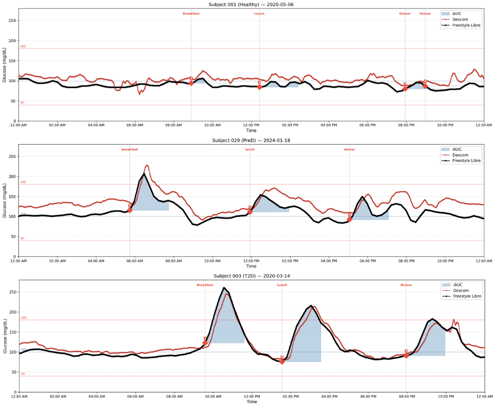
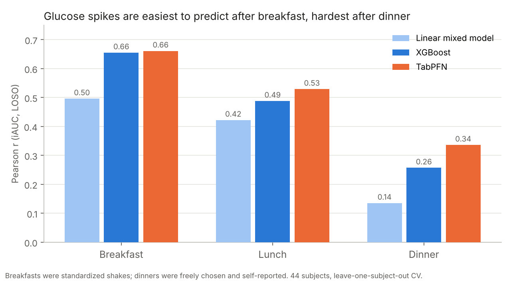
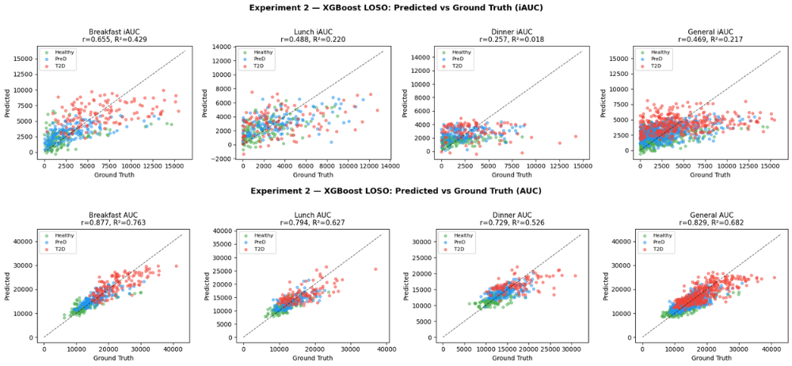
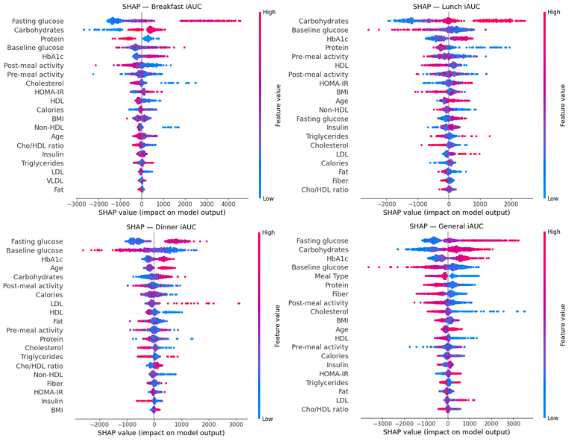
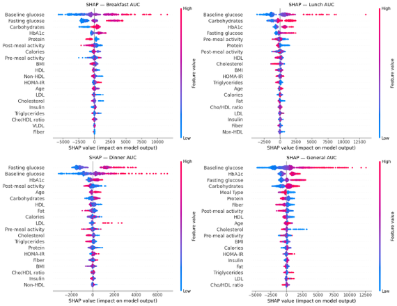
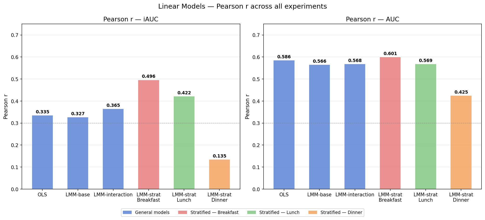

# Postprandial Glucose Response Prediction Using CGM and Nutritional Data

Research project for the **Advanced Biomedical Machine Learning** course at the **University of Pavia** (MSc Data Science, Year I, Semester II, Erasmus+ exchange). 

**Can we predict how much a person's blood sugar will rise after a meal?** The same meal can cause a big glucose spike in one person and almost none in another. Predicting this response is a key step toward personalized nutrition and diabetes prevention.

*24 hours of continuous glucose monitoring for one healthy, one pre-diabetic and one type-2 diabetic participant. Shaded areas are the post-meal glucose spikes (iAUC) that we predict.*

## Research questions

1. How do linear mixed-effects models, gradient boosting and a tabular foundation model (TabPFN) compare at predicting glucose response?
2. Does training a separate model for each meal type (breakfast, lunch, dinner) help?
3. Which features drive the predictions?

## Data

[CGMacros](https://www.nature.com/articles/s41597-025-05851-7) (Das et al., 2025): 45 adults over 10 days, healthy, pre-diabetic and type-2 diabetic. The data combines continuous glucose monitors, smartwatch activity, logged meals with macronutrients and a clinical blood panel.

After cleaning, the dataset has **1,170 meals from 44 subjects**. For each meal we computed two targets over the 2 hours after eating:

- **AUC:** the total glucose exposure
- **iAUC:** the glucose spike above the pre-meal level, which is harder to predict

## Method

- **Features:** meal macronutrients, baseline glucose, clinical markers (HbA1c, fasting glucose, insulin, HOMA-IR, lipids, BMI, age) and physical activity before and after the meal.
- **Models:**
  - linear models: OLS and three mixed-effects variants with a random intercept per subject (`statsmodels`)
  - XGBoost
  - TabPFN, a transformer pre-trained for tabular data
- **Evaluation:** Leave-One-Subject-Out cross-validation. The test person is never seen during training, which prevents subject-level data leakage. Metrics: Pearson r, RMSE, MAE and R².
- **Explainability:** SHAP for XGBoost (TreeExplainer) and TabPFN (PermutationExplainer). For the mixed-effects models we also looked at the fixed-effect coefficients.

## Results

- **Meal context matters more than the model.** All models predict breakfast best and dinner worst. Breakfasts were standardized shakes, while dinners were freely chosen and self-reported.
- **TabPFN matches or slightly beats XGBoost without any hyperparameter tuning:** iAUC r = 0.66 and AUC r = 0.89 on breakfast.
- **Our XGBoost reproduces the original CGMacros results** on breakfast: AUC r = 0.873 vs. 0.885 reported, iAUC r = 0.642 vs. 0.645.
- **Total exposure is much easier to predict than the spike:** AUC r is up to 0.89, iAUC r up to 0.66.
- **Top predictors** across models are carbohydrates, HbA1c, fasting glucose and baseline glucose. Post-meal physical activity significantly lowers the spike (p < 0.001).

More figures: SHAP and linear models

## Authors

[Laura-Vanesa Lungu](https://github.com/LVanesa) and [Oana-Maria Cochiorca](https://github.com/oanamaria10), University of Pavia.
